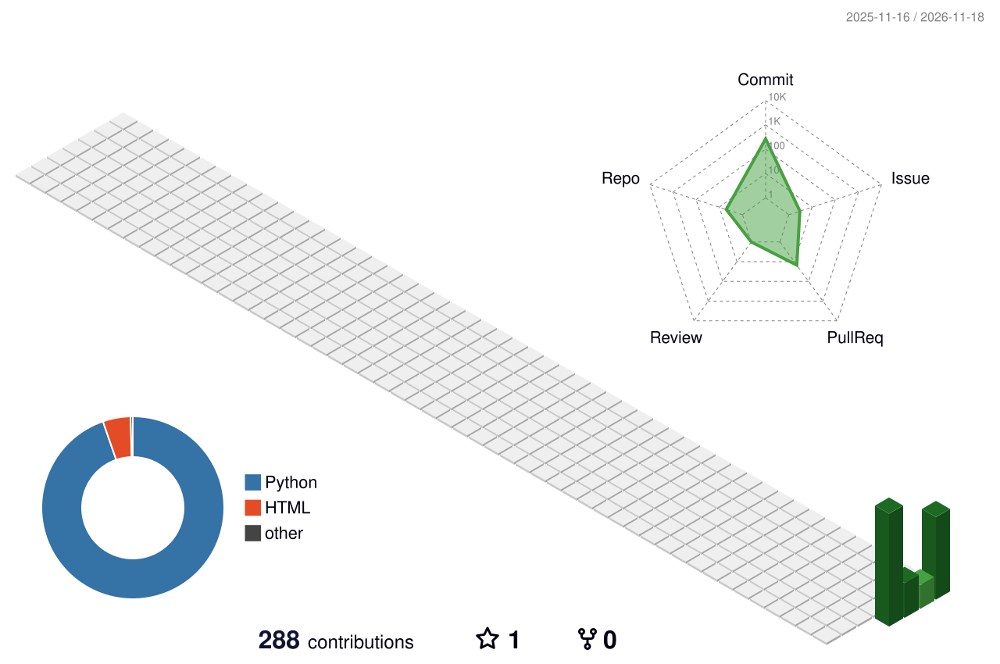

<!-- M34nX // DIGITAL EMPIRE -->
<div align="center">

<a href="https://m34nx.github.io/M34nX/">

</a>

<a href="https://m34nx.github.io/M34nX/"></a>


<br/>


</div>

---

## ▸ SYSTEM IDENTITY

```yaml
operator: M34nX
designation: independent learner
interests:
  - software and open source
  - automation and Linux
  - experimenting with technology
operating_mode: learn / build / improve
directive: understand deeply; create deliberately
```

> Curious by default. Focused on learning how systems work — and building useful things with them.

## ▸ ENTER THE LIVE EXPERIENCE

The full interactive experience lives outside the README, where real web technologies can run:

**[OPEN M34nX DIGITAL EMPIRE ↗](https://m34nx.github.io/M34nX/)**

- Interactive Three.js energy core with pointer/touch rotation
- Live public GitHub metrics, repository feed, and language footprint
- Local command terminal with safe built-in commands
- Three visual palettes, animated starfield, responsive layout
- Optional synthesized ambient tone (off by default)
- Automatic GitHub Pages deployment workflow

## ▸ TECH STACK

<div align="center">


</div>

## ▸ GITHUB TELEMETRY

<div align="center">
  
  
</div>

<div align="center">
  
  
</div>

## ▸ CONTRIBUTION MATRIX

<div align="center">


</div>

## ▸ FEATURED REPOSITORY

<div align="center">
<a href="https://github.com/M34nX/Termux-Shizuku-Bridge">

</a>
</div>

---

<div align="center">
<sub>GHOST PROTOCOL ∞ · LIVE DIGITAL IDENTITY · M34nX</sub>
<br/><a href="https://github.com/M34nX">SOURCE CODE</a> · <a href="https://m34nx.github.io/M34nX/">LIVE EXPERIENCE</a>
</div>
